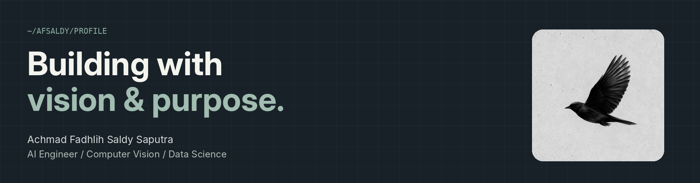

<!-- Alternative version: editable GitHub Markdown instead of a single full panel image -->
<div align="center">
  
</div>

### `$ cat about_me.py`

```python
name = "Fadhlih Saldy"
background = "Physics · Instrumentation"
focus = ["Computer Vision", "Real-time AI"]
building = "Reliable video analytics pipelines"
```

<table>
  <tr>
    <td width="50%" valign="top">
      <h3>// toolchain</h3>
      
      
      
      
      
      
    </td>
    <td width="50%" valign="top">
      <h3>// selected work</h3>
      <p><strong>People Counting</strong><br /><sub>Real-time detection, tracking & analytics</sub></p>
      <p><strong>RTSP Analytics</strong><br /><sub>Video streaming & inference pipelines</sub></p>
    </td>
  </tr>
</table>

<div align="center">
  <a href="https://github.com/afsaldy">github</a> &nbsp;·&nbsp;
  <a href="https://www.linkedin.com/in/achmad-fadhlih-saldy-saputra/">linkedin</a> &nbsp;·&nbsp;
  <a href="https://www.instagram.com/saldy_eizy/">instagram</a>
</div>
