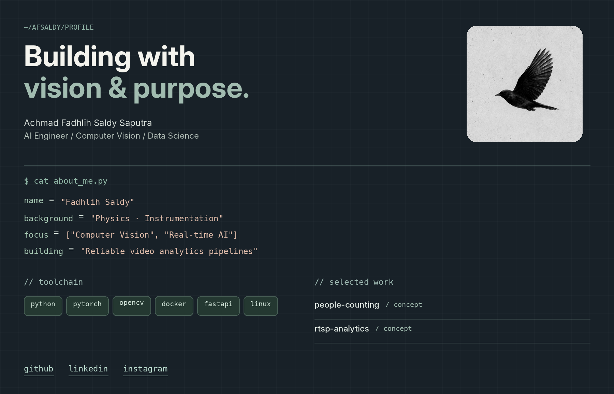

<!-- GitHub profile README for https://github.com/afsaldy -->
<!-- Put README.md at repository root and keep the assets/ folder next to it. -->

  

  
    <a href="https://github.com/afsaldy">github</a>
    &nbsp;&nbsp;·&nbsp;&nbsp;
    <a href="https://www.linkedin.com/in/achmad-fadhlih-saldy-saputra/">linkedin</a>
    &nbsp;&nbsp;·&nbsp;&nbsp;
    <a href="https://www.instagram.com/saldy_eizy/">instagram</a>
  

<!--
THEME: Midnight Slate
The artwork above is a PNG so that the dark grid, precise typography,
colors, and bird illustration display consistently on GitHub.

The social links under the artwork are real, clickable HTML links.
To change the text inside the artwork, edit/rebuild the image asset.
See README-editable.md for a text-based alternative with native Markdown.
-->
